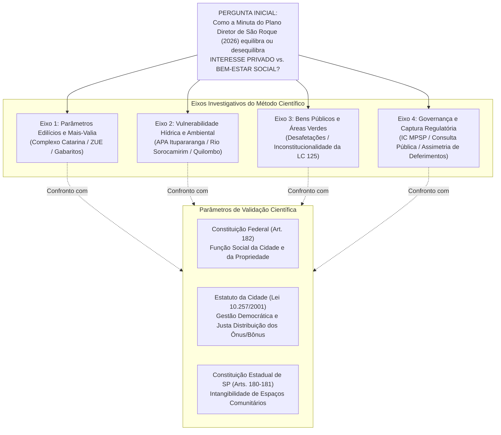

# Momento 1: A Pergunta Inicial (Pergunta de Partida)
## Investigação Científica da Minuta de Atualização do Plano Diretor de São Roque (2026)
### Tensão Analítica Central: Interesse Privado vs. Bem-Estar Social e Função Social da Cidade

---

### 1. Enquadramento Metodológico e Epistêmico

Na metodologia científica aplicada ao planejamento urbano, às ciências sociais e ao direito urbanístico (conforme matriz analítica de Quivy & Campenhoudt e David Harvey), o **Momento 1** consiste na definição rigorosa da **Pergunta de Partida** (*Question de départ*).

Para garantir a validade científica da investigação e evitar vieses moralizantes, a formulação atende estritamente a três critérios fundamentais:

1. **Critério da Clareza (Precisão Conceitual)**:
   - Termos bem definidos, unívocos e mensuráveis. 
   - A pesquisa investiga *mecanismos regulatórios, cartográficos e fiscais*, e não intenções subjetivas.
2. **Critério da Exequibilidade (Aderência Empírica)**:
   - Respaldo pleno no acervo documental já estruturado no Lakehouse:
     - Minutas das LCs 39 e 40 (protocoladas na Câmara em 14/10/2026).
     - Cartas de Zoneamento (2006 vs. 2026).
     - Dossiês periciais (Complexo Catarina, Bairro do Carmo, Desafetações/TJ-SP, Governança/MPSP).
     - Andamento das Audiências Públicas no Poder Legislativo (iniciadas em 12/11/2026).
3. **Critério da Pertinência (Ruptura com o Senso Comum e Neutralidade Axiológica)**:
   - Deslocamento de juízos de valor pré-concebidos para a identificação objetiva dos *efeitos distributivos do ordenamento territorial*: quem se apropria da mais-valia fundiária criada pelas novas normas e quem absorve as externalidades negativas (ambientais, hídricas, viárias e sociais).

---

### 2. A Pergunta Inicial de Partida (Macro-Pergunta)

> ### 🎯 Pergunta Central da Pesquisa:
> **"Em que medida e por meio de quais dispositivos urbanísticos, cartográficos e procedimentais a Minuta de Revisão do Plano Diretor de São Roque (2026) consolida ou neutraliza a prevalência de interesses imobiliários privados sobre a função social da propriedade e a salvaguarda socioambiental coletiva?"**

---

### 3. Matriz de Desdobramentos Operacionais (Eixos Investigativos e Hipóteses)

A partir da Pergunta de Partida, desdobram-se quatro eixos temáticos que orientarão as etapas subsequentes do método científico (Exploração, Construção das Hipóteses e Testagem Empírica):

| Eixo Analítico | Questão Secundária / Pergunta Operacional | Objeto Empírico / Dossiê Associado | Hipótese Preliminar |
| :--- | :--- | :--- | :--- |
| **Eixo 1: Zoneamento e Mais-Valia Fundiária** | *Quais parâmetros edilícios (gabarito, taxa de ocupação, coeficiente) foram flexibilizados para grandes empreendimentos e como isso redefine o valor da terra?* | **Caso 01**: Complexo Catarina (JHSF), Rodovia Castello Branco (ZUE, gabarito de 30m vs. restrições do PBZPA ao entorno). | Houve assimetria regulatória na concessão de potenciais construtivos privilegiados a empreendimentos corporativos de grande porte em detrimento do ordenamento do entorno rural/periurbano. |
| **Eixo 2: Sensibilidade Socioambiental e Mananciais** | *Como a minuta trata as bacias de abastecimento e áreas tradicionais frente às pressões de parcelamento fechado?* | **Caso 03**: Bairro do Carmo, APA Represa de Itupararanga, Bacia do Sorocamirim e Território Quilombola (Minuta LC 40, pág. 36). | A consagração de regras contratuais privadas em substituição às restrições municipais fragiliza a proteção de mananciais de abastecimento público. |
| **Eixo 3: Patrimônio Público e Desafetações** | *A alienação onerosa de bens públicos institucionais e áreas verdes cumpre a função social da cidade ou atua como ativo financeiro suplementar?* | **Caso 02**: Desafetações da LC 125/2022 (inconstitucional pelo TJ-SP), Leilão PNCP 01/2025 e Gleba Marmeleiro. | A desafetação de áreas verdes e institucionais reduz espaços públicos comunitários para monetização patrimonial imediata, em confronto com os arts. 180 e 181 da CE/SP. |
| **Eixo 4: Governança, Higidez e Participação Social** | *Em que medida a condução dos estudos técnicos e a recepção das propostas populares refletiram uma gestão democrática efetiva da cidade?* | **Caso 05**: Inquérito Civil MPSP nº 0439.0000192/2025 (probidade em geoprocessamento) e disparidade no acolhimento de propostas (CRECI vs. COMDEMA). | O processo participativo apresentou assimetria decisória, acolhendo com celeridade pleitos de conversão de solo pelo mercado imobiliário e postergando diretrizes de controle ecológico dos órgãos colegiados. |

---

### 4. Diagrama Conceitual da Investigação

---

### 5. Próximos Passos no Método Científico

- **Momento 2**: A Fase Exploratória (Revisão da Literatura, Análise Jurisprudencial do TJSP/STJ e Mapeamento dos Fatos Relevantes).
- **Momento 3**: Construção do Modelo de Análise (Conceitualização e Sistema de Hipóteses e Variáveis).
- **Momento 4**: Coleta e Estruturação de Dados (Cruzamento vetorial SIG / KMZ com a Base do Lakehouse).
- **Momento 5**: Análise das Evidências e Conclusões Periciais.
