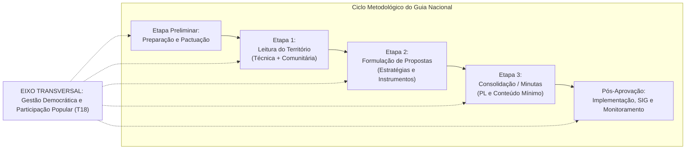

# Catálogo do Acervo Territorial à Luz do Guia Nacional de Planos Diretores
## Avaliação Sistemática do Lakehouse de São Roque Frente às Diretrizes do MDR / ConCidades / Estatuto da Cidade

---

### 1. Enquadramento Teórico-Metodológico do Guia

O **Guia para Elaboração e Revisão de Planos Diretores** (Ministério do Desenvolvimento Regional / Cooperação Alemã GIZ / ConCidades) estrutura o processo de planejamento urbano em um ciclo articulado em **três etapas procedimentais**, integradas por um **eixo transversal de participação social** e desdobradas em **18 temas estruturantes** e um **Quadro de Conteúdo Mínimo Obrigatório** (art. 42 da Lei Federal nº 10.257/2001 e Resolução ConCidades nº 34/2005):



A seguir, cataloga-se o acervo de **87 documentos, cartas geoespaciais, decisões judiciais e dossiês periciais** atualmente disponíveis no repositório, mapeando o grau de completude, os achados técnicos e as lacunas analíticas em relação a cada exigência do Guia.

---

### 2. Matriz de Catalogação: Etapas Procedimentais do Guia vs. Acervo do Lakehouse

| Etapa Metodológica do Guia | Exigências e Produtos Mínimos do Guia | Acervo Disponível no Repositório (Bronze / Dossiês) | Avaliação de Cobertura e Status Epistêmico |
| :--- | :--- | :--- | :--- |
| **Etapa de Preparação** | • Plano de Trabalho e Termo de Referência<br>• Equipe técnica multidisciplinar<br>• Contratos de consultoria e geotecnologias<br>• Cronograma e canais de comunicação | • `Contrato 138/2023` (Geo Pixel - R$ 628 mil)<br>• `Contrato 142/2024` (Geo Pixel - R$ 752 mil)<br>• `Pregão 084/2022` (Oliver Arquitetura - suspenso)<br>• `IC MPSP nº 0439.0000192/2025` (Inquérito civil por improbidade e enriquecimento ilícito)<br>• `Ação Popular nº 1003444-84.2023` (TJSP)<br>• `CASO_05_GOVERNANCA_DPMA_CONSULTA_PUBLICA.md` | **Alta Cobertura Crítica**.<br>Documentação completa das contratações técnicas da base cadastral e dos questionamentos judiciais e ministeriais que pesam sobre a fase preparatória. |
| **Etapa 1: Leitura do Território (Diagnóstico Técnico)** | • Caracterização biofísica, geologia e relevo<br>• Hidrografia, mananciais e bacias<br>• Inventário da cobertura vegetal e APPs<br>• Mapeamento de risco a desastres (Lei 12.608/12)<br>• Saneamento básico e esgotamento<br>• Base demográfica e socioeconômica | • 15 Pranchas temáticas do PDA 2019 (Geologia, Pedologia, Declividade, Altimetria, MDT, Uso do Solo, Fragilidade Potencial)<br>• `INVENTARIOflorestal_livroFINAL.pdf` (180 MB)<br>• `PDA 2019.pdf` e `Cartilha_Pedagogica_Oficial_PDA_2019.pdf`<br>• `SGB_CPRM_2023_Mapeamento_Riscos_Desastres.pdf`<br>• `Mapeamento_22_Areas_Risco_Deslizamentos.pdf`<br>• `SNIS_Painel_Saneamento_Brasil_Sao_Roque.xlsx`<br>• `ARSESP_Relatorio_Analitico_Saneamento.pdf`<br>• `sao_roque_3550605_setores_CD2022.kmz` (Censo IBGE 2022) | **Cobertura Exaustiva (Nível 1)**.<br>Diagnóstico ambiental e físico hiperdetalhado. Permite confrontar qualquer nova mancha de zoneamento com cartas de declividade, vulnerabilidade hídrica e risco de deslizamento. |
| **Etapa 1: Leitura do Território (Leitura Comunitária)** | • Percepção social das problemáticas<br>• Oficinas territoriais e escuta pública<br>• Registro e sistematização das demandas populares | • `07_Sugestoes_Comentadas_Consulta_Publica_Devolutiva_Oficial_74_Pags.pdf`<br>• `CASO_05_GOVERNANCA_DPMA_CONSULTA_PUBLICA.md`<br>• `DOM_Edicao_1003_13-11-2026` e `DOM_Edicao_1007_19-11-2026` (Decretos e Atas) | **Cobertura Plena**.<br>Possui o documento integral de devolutiva (74 páginas) com todas as 57 sugestões da população, indicando autor, teor, parecer do DPMA e deferimento/indeferimento. |
| **Etapa 2: Formulação de Propostas e Instrumentos** | • Macrozoneamento (Rural, Urbano, Proteção)<br>• Zoneamento de Uso e Ocupação do Solo<br>• Parâmetros edilícios (CA, TO, Gabarito, Lote Mínimo)<br>• Instrumentos indutores (PEUC, IPTU Progressivo, OODC, TDC, Preempção, ZEIS)<br>• Regime de áreas públicas | • Base cartográfica vigente: `PMD2006 - Zoneamento.kmz` e Cartas I a X (PDFs)<br>• Legislação de referência: `LC 39/2006`, `LC 40/2006`, `LC 65/2008`, `LC 102/2020`<br>• Criação de Zonas Especiais: `LC 66/2012` (ZUCAer / Catarina)<br>• Proposta de Zoneamento 2026: `zoneamentos_pl_2026.kmz` e `cartas_pl_(1)_29093803.pdf`<br>• `Anexos_Oficiais_Indices_Urbanisticos_Minuta_LC40_2026.pdf`<br>• Alienação e desafetação: `LC 125/2022`, `Lei 5496/2022`, `Acórdão ADIN 2048131-35.2024 (TJSP)`, `PNCP Edital Leilão 001/2024` e matrículas CRI | **Alta Cobertura Documental e Espacial**.<br>Possibilita o confronto espacial direto (GIS) entre os limites de 2006 e 2026, além de auditoria sobre os instrumentos econômicos e patrimoniais. |
| **Etapa 3: Consolidação e Projeto de Lei** | • Minuta do Projeto de Lei do Plano Diretor<br>• Minuta da Lei de Uso, Ocupação e Parcelamento<br>• Justificativa técnica e anexos de mapas oficiais<br>• Protocolo formal no Legislativo | • `01_Minuta_LC_39_2006_Plano_Diretor_Estrategico_65_Pags.pdf`<br>• `02_Minuta_LC_40_2006_Zoneamento_Uso_Ocupacao_62_Pags.pdf`<br>• `03_Minuta_LC_39_Revisao_Final_Protocolada_Camara.pdf`<br>• `04_Minuta_LC_40_Revisao_Final_Protocolada_Camara.pdf`<br>• `05_Minuta_Projeto_Lei_Revisao_LC39_Texto_Legal.pdf`<br>• `06_Minuta_Projeto_Lei_Revisao_LC40_Texto_Legal.pdf` | **Cobertura Completa e Atualizada**.<br>Contém tanto as minutas submetidas à consulta quanto os textos finais protocolados na Câmara Municipal em 14/10/2026. |

---

### 3. Catalogação por Temas Estruturantes do Guia (T1 a T18)

O Guia Nacional categoriza o conteúdo substancial do Plano Diretor em **18 Temas**. Abaixo, detalha-se como os arquivos do Lakehouse respondem a cada tema sob a ótica da tensão **Interesse Privado vs. Bem-Estar Social**:

```text
TEMAS DO GUIA NACIONAL           CORRESPONDÊNCIA NO ACERVO DO LAKEHOUSE
─────────────────────────────────────────────────────────────────────────────────────────────
[T1]  Habitação                 -> Setores Censitários IBGE 2022; Caso 04 (REURB e parcelamentos rurais).
[T2]  Expansão Urbana           -> Vetores ZEU/ZUR no KMZ 2026 vs. KMZ 2006; Conversão de áreas rurais.
[T3]  Dinâmica Imobiliária      -> Caso 01 (Catarina JHSF); Matrículas CRI 32063/45376/24354; Devolutiva CRECI.
[T5]  Qualidade Urbana/Amb.     -> Cartilha PDA 2019; Mapas de Fragilidade Potencial e Uso do Solo.
[T6]  Patrimônio Cultural       -> Caso 03 (AEIA 7 - Quilombo do Carmo / ITESP); Rota do Vinho.
[T7]  Uso e Ocupação do Solo    -> Minutas LC 40/2026; Anexos de Índices Urbanísticos; Histórico LC 40/2006.
[T8]  Desenvolvimento Econômico -> Eixo Castello Branco (LC 66/2012 ZUCAer); Pólo Turístico e Gastronômico.
[T9]  Grandes Projetos Impacto  -> Caso 01 (Complexo Catarina: Aeroporto Executivo, Outlet, Catarina Town); Licenças CETESB.
[T10] Meio Ambiente             -> 15 Cartas PDA 2019; Inventário Florestal; Lei Estadual 11.579/03 (APA Itupararanga).
[T11] Saneamento Ambiental      -> SNIS Saneamento; ARSESP SABESP São Roque; CBH-SMT (Cobrança Hídrica).
[T12] Mobilidade e Transporte   -> Sistema Viário 2006 (Cartas IX/X); PBZPA DECEA (Restrições Cone de Aproximação Raio 10 km).
[T13] Desenv. Rural Sustentável -> Caso 04 (Fracionamento irregular, módulo INCRA 20.000 m²); Uso Agrícola PDA.
[T14] Equipamentos Públicos     -> Caso 02 (Desafetação LC 125/22 - ADIN TJSP; Alienação Leilão PNCP 01/2025).
[T15] Turismo                   -> Zonas de Interesse Turístico; Regime de Loteamentos no Bairro do Carmo (Caso 03).
[T16] Áreas de Risco à Vida     -> SGB/CPRM 2023 (Mapeamento Geológico); 22 Áreas Críticas de Inundação e Deslizamento.
[T17] Financiamento Urbano      -> Laudos de avaliação em leilões públicos de áreas desafetadas; Prestação contas DOM.
[T18] Gestão Democrática        -> Caso 05; Devolutiva Consulta Pública (74 págs); Inquérito MPSP 0439; Audiências Câmara.
```

---

### 4. Análise de Conformidade com o Conteúdo Mínimo do Estatuto da Cidade (Art. 42)

O Guia exige a verificação dos conteúdos mínimos legalmente obrigatórios:

| Requisito do Art. 42 da Lei 10.257/2001 | Disposição na Minuta 2026 de São Roque | Documentos Probatórios no Lakehouse | Avaliação Pericial |
| :--- | :--- | :--- | :--- |
| **I. Função Social da Propriedade e da Cidade** | Prevista de forma principiológica no Título I da Minuta da LC 39/2026. | `01_Minuta_LC_39...pdf` e `03_Minuta_LC_39_Revisao_Final...pdf` | **Conformidade Formal**.<br>Apresenta declaração textual de princípios, mas requer auditoria sobre a eficácia prática dos mecanismos sancionatórios. |
| **II. Delimitação de Áreas para PEUC e IPTU Progressivo** | Áreas centrais e corredores urbanos com previsão de aplicação sucessiva (arts. 5º a 8º do Estatuto). | Minuta LC 39/2026 e Tabela de Índices | **Alerta Crítico**.<br>Histórico municipal de 2006 a 2026 revela baixa ou nula aplicação efetiva do PEUC, favorecendo a retenção especulativa de glebas. |
| **III. Delimitação de Áreas para OODC, TDC e Preempção** | Previsão genérica na LC 39 com remessa a leis específicas posteriores. | Minuta LC 39 (Capítulo de Instrumentos da Política Urbana) | **Risco de Ineficácia**.<br>A postergação da regulamentação da Outorga Onerosa impede a recuperação pública da mais-valia criada pelo novo zoneamento. |
| **IV. Gestão Democrática e Controle Social** | Conselho da Cidade (CONCIDADE) e conferências municipais. | `07_Sugestoes_Comentadas_Consulta_Publica...pdf` e `CASO_05` | **Antinomia Documentada**.<br>Registros oficiais comprovam que órgãos colegiados ambientais (COMDEMA) tiveram propostas postergadas, enquanto entidades imobiliárias obtiveram deferimentos pontuais imediatos. |
| **V. Áreas de Risco e Medidas Preventivas (Lei 12.608/12)** | Diretrizes de macrozoneamento incorporando áreas de preservação e encostas. | `SGB_CPRM_2023...pdf` e `Mapeamento_22_Areas_Risco...pdf` | **Adequação Técnica Subjacente**.<br>O município possui a base CPRM e municipal de risco, permitindo sobreposição direta com as novas zonas de expansão urbana propostas. |

---

### 5. Dossiês Emblemáticos: A Síntese Empírica do Conflito "Interesse Privado x Bem-Estar Social"

O acervo contém 5 dossiês de análise territorial e jurídica que operacionalizam a investigação científica:

1. **Caso 01 — Complexo Catarina (JHSF)**:
   * *Objeto*: Unicidade dominial da Fazenda Dona Catarina (5,2 mi m²), Fatos Relevantes CVM (2008–2026), criação da ZUCAer (LC 66/2012) e parâmetros privilegiados na Minuta 2026 (ZUE com gabarito de 30m e TO de 50% vs. restrições do PBZPA/DECEA impostas aos vizinhos num raio de 10 km).
2. **Caso 02 — Desafetações e Leilão de Áreas Públicas (Marmeleiro / PNCP)**:
   * *Objeto*: Declaração de inconstitucionalidade da LC 125/2022 pelo Órgão Especial do TJ-SP (violação dos arts. 180 e 181 da CE/SP); divergência métrica de 18,02% no lance mínimo da Matrícula 24.354 (Edital PNCP 01/2025) e cruzamento com financiamento eleitoral (TSE).
3. **Caso 03 — Bairro do Carmo, Sorocamirim e Território Quilombola**:
   * *Objeto*: Exame do § 1º da Minuta da LC 40/2006 (pág. 36), que excepciona as regras gerais e consagra contratos padrões de 4 loteamentos fechados inseridos na APA de Itupararanga e na zona de amortecimento da AEIA 7 (Quilombo do Carmo).
4. **Caso 04 — Parcelamento Rural Irregular, INCRA e REURB**:
   * *Objeto*: Conflito entre a fração mínima de parcelamento rural do INCRA (2,0 ha / 20.000 m²) e a proliferação de chácaras de recreio com fracionamento clandestino (< 1.000 m²), avaliando o uso distorcido da REURB como indutor de expansão urbana sem saneamento.
5. **Caso 05 — Governança Institucional, Contratações e Consulta Pública**:
   * *Objeto*: Auditoria das contratações de SIG (Geo Pixel - R$ 1,47 mi), inquérito civil no MPSP (`IC 0439.0000192/2025`), Ação Direta de Inconstitucionalidade da PGJ (`ADIN 2191432-40.2024`) e exame comparativo do acolhimento de sugestões na Consulta Pública.

---

### 6. Lacunas Analíticas Identificadas e Oportunidades para o Momento 2

À luz do Guia Nacional, os seguintes pontos merecem aprofundamento investigativo na fase de testes empíricos:
1. **Modelagem Quantitativa de Mais-Valia Fundiária**: Cálculo da valorização imobiliária decorrente da simples reclassificação de solo rural/ambiental para solo urbano (ZUR/ZEU) nas glebas lindeiras à Rodovia Castello Branco e Estrada do Candor.
2. **Capacidade de Suporte Hídrico e Saneamento**: Confrontar as metas do Plano Municipal de Saneamento e do contrato SABESP/ARSESP com os adensamentos populacionais autorizados pelas novas minutas nos bairros isolados (Carmo, Mailasqui, São João Novo).
3. **Sobreposição Espacial GIS de Áreas de Risco vs. ZEU**: Verificar se há polígonos de expansão urbana sobrepostos aos 22 setores de risco geológico identificados pela CPRM.
