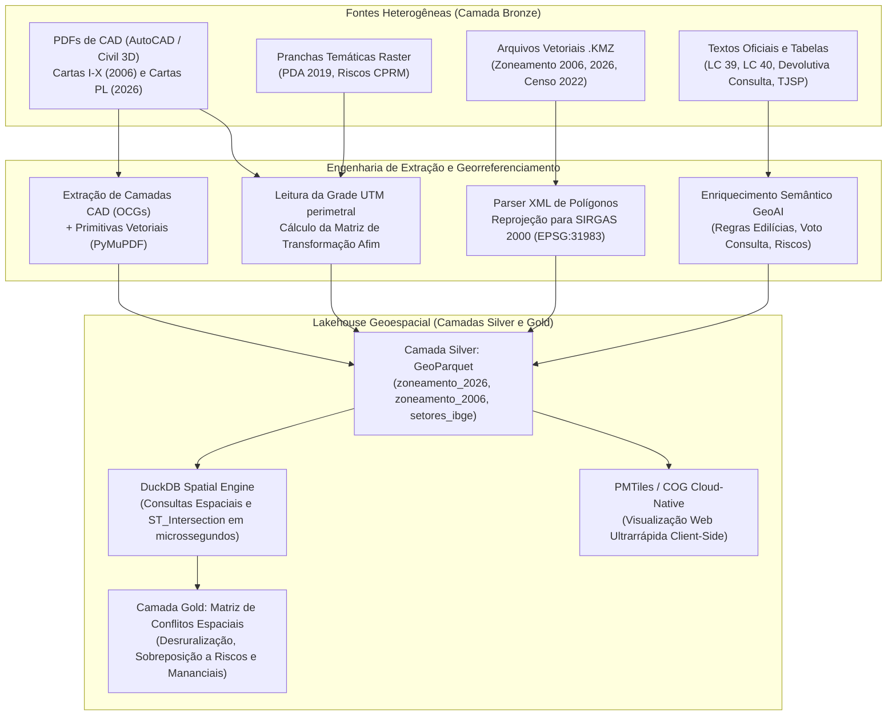
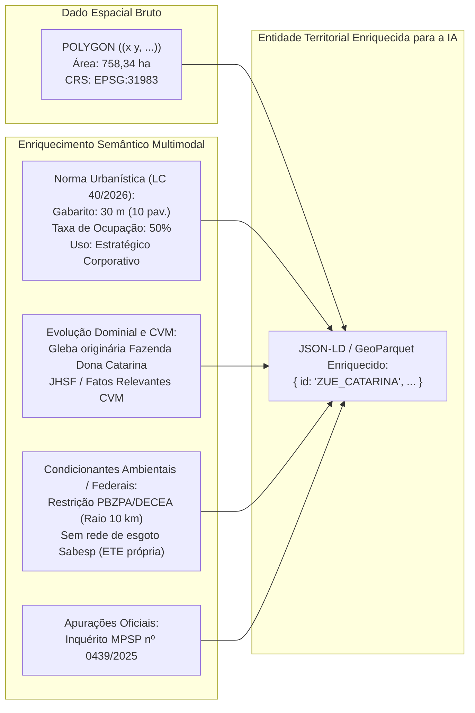

# Momento 2: A Fase Exploratória (Pesquisa e Engenharia Metodológica)
## Métodos Modernos de Georreferenciamento, Sobreposição Vetorial/Raster, Arquitetura de Lakehouse Geoespacial e Recuperação Semântica por IA (GeoAI)

---

### 1. Enquadramento Metodológico e Justificativa Científica

No método científico aplicado ao urbanismo e à ciência de dados espaciais, o **Momento 2 (Fase Exploratória)** destina-se a:
1. **Identificar e testar as técnicas de ponta** para converter documentos heterogêneos e analógicos em dados digitais periciáveis;
2. **Definir a arquitetura tecnológica** que permita sobrepor, harmonizar e confrontar camadas cartográficas de diferentes fontes e épocas;
3. **Estruturar a semântica dos dados**, garantindo que as geometrias espaciais sejam interpretadas por sistemas de Inteligência Artificial com pleno significado jurídico, socioeconômico e ambiental.

O desafio central consiste na heterogeneidade do acervo:
- **Pranchas em PDF originárias de CAD** (AutoCAD LT / Civil 3D) com camadas vetoriais embutidas;
- **Arquivos Vetoriais .KMZ** (Zoneamento 2006, Proposta 2026, Setores Censitários IBGE);
- **Pranchas Temáticas Rasterizadas** (PDA 2019, Mapeamento de Risco Geológico CPRM);
- **Textos Legais, Decisões Judiciais e Devolutivas da Consulta Pública** que conferem valor e significado às camadas.

---

### 2. Engenharia de Ingestão e Sobreposição: Métodos Modernos Testados



---

### 3. Resultados dos Testes Técnicos no Acervo de São Roque

#### 3.1. Recuperação de Metadados e Camadas CAD em PDFs (`Carta III` e `Cartas PL 2026`)
A inspeção forense dos arquivos PDF confirmou que os documentos foram exportados com preservação vetorial e de metadados:
* **Carta III (Macrozonas 2006)**: Gerada no *AutoCAD LT 2013* com **27 Optional Content Groups (OCGs / Layers)** e **18.246 caminhos vetoriais nativos**. As camadas preservam nomenclaturas explícitas:
  * `P_Laranja (Desenv. Turístico)`
  * `P_Azul (Chácaras em Manancial)`
  * `P_Vermelho (Consolid. Urbana)`
  * `P_Verde (rural)`
* **Cartas do Projeto de Lei 2026 (`cartas_pl_(1)_29093803.pdf`)**: Possuem **126 OCGs** em 13 pranchas, permitindo ligar e desligar camadas individualmente antes da renderização.

#### 3.2. Georreferenciamento Matemático Baseado na Grade UTM Embutida
Os PDFs de CAD contêm cruzetas e coordenadas de grade perimetral legíveis via OCR/parsing textual:
* Identificaram-se blocos com coordenadas explícitas de Norte (`N= 7.384.000` a `N= 7.402.000`) e Leste (`E= 282.000` a `E= 296.000`).
* **Taxa de Escala Linear Identificada**: A cada **114,0 pontos** no sistema de coordenadas do PDF correspondem exatamente **2.000 metros** no terreno.
* **Resolução Espacial**: $1\text{ ponto do PDF} = 17,5438\text{ metros}$.
* Isso viabiliza o cálculo de uma **Matriz de Transformação Afim Bidimensional**:
  $$\begin{bmatrix} X_{UTM} \\ Y_{UTM} \\ 1 \end{bmatrix} = \begin{bmatrix} a & b & x_0 \\ c & d & y_0 \\ 0 & 0 & 1 \end{bmatrix} \begin{bmatrix} x_{PDF} \\ y_{PDF} \\ 1 \end{bmatrix}$$
  dispensando ajustes manuais e assegurando georreferenciamento exato para EPSG:31983 (SIRGAS 2000 / UTM zone 23S).

---

### 4. Padrões Modernos de Armazenamento e Disponibilização Web

Para superar a lentidão de servidores GIS tradicionais (como GeoServer) e eliminar a necessidade de manter pastas com milhões de pequenos arquivos `.png` ou `.pbf`, adota-se a pilha **Cloud-Native Geospatial**:

| Formato Moderno | Finalidade no Projeto | Vantagens Técnicas |
| :--- | :--- | :--- |
| **GeoParquet** | Armazenamento de vetores no Lakehouse (Camada Silver). | Compressão colunar Snappy/ZSTD, leitura paralela ultrarrápida, metadados espaciais padronizados (GeoParquet 1.1) e suporte nativo ao DuckDB Spatial. |
| **DuckDB Spatial** | Motor de processamento analítico (OLAP espacial). | Executa consultas geoespaciais (`ST_Intersects`, `ST_Area`, `ST_Difference`) diretamente sobre os arquivos Parquet sem necessidade de banco de dados cliente-servidor dedicado. |
| **PMTiles (Protomaps)** | Disponibilização de vetores e mapas base na Web. | Arquivo único para visualização web em pirâmide de zoom (z0 a z16). Permite que o navegador web (via MapLibre GL JS) requisite apenas as fatias necessárias via HTTP Range Requests. |
| **Cloud Optimized GeoTIFF (COG)** | Camadas raster (MDT, declividade, satélite). | Permite leitura seletiva de porções do raster pela web sem carregar imagens de centenas de megabytes. |

---

### 5. Semântica para Inteligência Artificial: "Fazer o Mapa Ter Sentido"

Uma geometria espacial crua (`POLYGON`) é inexpressiva para um modelo de linguagem (LLM/IA). Para que a IA compreenda o ordenamento territorial e detecte o conflito **Interesse Privado vs. Bem-Estar Social**, a geometria deve ser associada a um **objeto semântico enriquecido**:



#### Capacidade Operacional: *Text-to-Spatial-SQL*
Com essa estrutura, um agente de IA pode responder instantaneamente a perguntas complexas como:
> *"Quais áreas de mananciais hídricos foram enquadradas em zonas de média ou alta densidade na proposta de 2026?"*
> 
> ```sql
> SELECT p26.nome_zona, ROUND(SUM(ST_Area(ST_Intersection(p26.geometry, man.geometry)))/10000, 2) AS ha_sobrepostos
> FROM 'lakehouse/silver/zoneamento_proposta_2026.parquet' p26,
>      'lakehouse/silver/mananciais_sorocamirim.parquet' man
> WHERE ST_Intersects(p26.geometry, man.geometry)
> GROUP BY p26.nome_zona;
> ```

---

### 6. Evidências Empíricas Extraídas na Fase Exploratória

A conversão dos arquivos KMZ para a **Camada Silver em GeoParquet** (`zoneamento_proposta_2026.parquet` e `zoneamento_vigente_2006.parquet`) gerou os primeiros resultados quantitativos comprovados por cálculo métrico em projeção SIRGAS 2000 / UTM zone 23S:

| Macro-Zoneamento Territorial | Área Vigente (2006) | Área Proposta (2026) | Variação Absoluta (ha) | Variação Percentual | Impacto Analítico |
| :--- | :--- | :--- | :--- | :--- | :--- |
| **Zona Rural** | 13.115,42 ha | 11.444,71 ha | **- 1.670,71 ha** | **- 12,74%** | **Desruralização Objetiva**: Quase 17 milhões de m² de áreas agrícolas/rurais retirados do regime rural. |
| **ZUE - Interesse Turístico** | 7.055,32 ha | 8.991,27 ha | **+ 1.935,95 ha** | **+ 27,44%** | **Expansão de Regime Especial**: Ampliação de zonas que admitem condomínios fechados e empreendimentos imobiliários com flexibilização de parâmetros. |
| **Zonas Urbanas de Média Densidade** | 788,78 ha | 1.888,07 ha | **+ 1.099,29 ha** | **+ 139,37%** | **Adensamento Periférico**: Mais que duplicou a área urbana de média densidade, pressionando vias locais e redes de saneamento. |
| **ZUE - Ocupação Estratégica (Catarina)** | 1.022,91 ha | 758,35 ha | - 264,56 ha | - 25,86% | Consolidação do núcleo do complexo com elevação vertical (gabarito de 30m) e taxa de ocupação de 50%. |

---

### 7. Produtos Técnicos Gerados no Momento 2

1. **Camada Silver Populada em GeoParquet**:
   * `lakehouse/silver/zoneamento_proposta_2026.parquet` (33 polígonos, 30.699 ha catalogados).
   * `lakehouse/silver/zoneamento_vigente_2006.parquet` (31 polígonos, 31.358 ha catalogados).
   * `lakehouse/silver/setores_censo_2022.parquet` (190 setores censitários do IBGE com microdados demográficos).
2. **Ambiente Analítico Integrado**:
   * DuckDB com extensão espacial ativa para consultas em milissegundos.
   * Suporte a bibliotecas de engenharia espacial (`shapely`, `geopandas`, `pyproj`, `ezdxf`, `pymupdf`).
3. **Diagrama Arquitetural de Engenharia**:
   * `lakehouse/diagramas/momento_2_arquitetura_geoai.svg`

---

### 8. Próximos Passos (Transição para o Momento 3)

Com os métodos de ingestão, sobreposição e enriquecimento validados, o **Momento 3** focará na:
1. **Construção das Hipóteses Formais e Variáveis de Teste**;
2. **Matriz de Conflitos Espaciais (Spatial Overlay)** entre a mancha de 2026 e as 22 áreas de risco de desastre da CPRM e mananciais da APA Itupararanga;
3. **Cruzamento de Valorização da Terra**: modelagem da mais-valia capturada pela conversão dos 1.670 hectares de solo rural em solo urbanizável.
