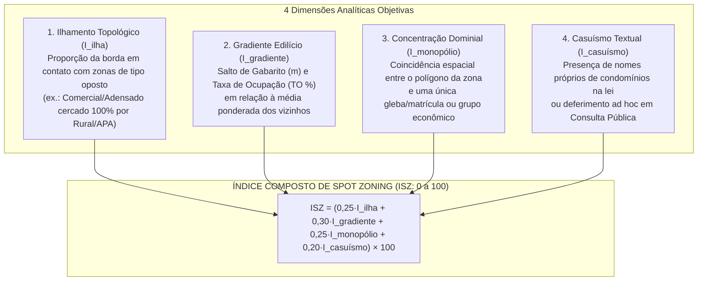

# Momento Científico: Modelagem e Cálculo do Spot Zoning
## Detecção Algorítmica e Métricas Espaciais de Zoneamento Casuístico na Minuta do Plano Diretor de São Roque (2026)

---

### 1. Definição Epistemológica e Jurídica

O **Spot Zoning** (ou *Zoneamento Casuístico / Ilhas de Privilégio*) é conceituado no Direito Urbanístico e na Análise Espacial como:
> *"A alteração pontual e cirúrgica do regime de zoneamento para conceder a uma gleba, lote ou pequeno grupo de imóveis parâmetros edilícios ou usos substancialmente mais permissivos ou lucrativos que os aplicáveis ao seu entorno imediato, sem justificativa baseada no planejamento urbano sistêmico ou na capacidade de suporte da infraestrutura pública."*

#### Enquadramento Constitucional e Jurisprudencial (STF / TJ-SP)
No ordenamento jurídico brasileiro, o *spot zoning* caracteriza vício material de inconstitucionalidade e improbidade por:
1. **Violação do Princípio da Impessoalidade e da Moralidade (CF/88, art. 37)**: Desvio de finalidade do ato legislativo para favorecer grupos ou proprietários privados determinados (*leis de efeito concreto disfarçadas de lei em tese*);
2. **Quebra da Isonomia e da Função Social da Cidade (CF/88, art. 5º e art. 182)**: Concessão de valorização imobiliária privativa (mais-valia fundiária) sem justa distribuição dos ônus e bônus da urbanização (Estatuto da Cidade, Lei 10.257/2001, art. 2º, IX);
3. **Ofensa aos arts. 180 e 181 da Constituição Estadual de SP**: Descontinuidade territorial e fragilização de áreas verdes ou mananciais.

---

### 2. A Modelagem Matemática: O Índice Científico de Spot Zoning ($ISZ$)

Para superar impressões subjetivas, desenvolvemos um **método quantitativo reprodutível** baseado em Estatística Espacial (*Spatial Statistics*), Teoria dos Grafos de Adjacência e Análise Morfológica Multivariada.

O **Índice Científico de Spot Zoning ($ISZ$)** para cada polígono $i$ é calculado pela combinação linear ponderada de quatro dimensões normalizadas no intervalo $[0, 1]$:

$$ISZ_i = \left( w_1 \cdot I_{\text{ilha}}(i) + w_2 \cdot I_{\text{gradiente}}(i) + w_3 \cdot I_{\text{monopólio}}(i) + w_4 \cdot I_{\text{casuísmo}}(i) \right) \times 100$$

Com pesos metodológicos fixados em:
* $w_1 = 0,25$ (Ilhamento Topológico / Dissimilaridade Espacial da Borda)
* $w_2 = 0,30$ (Gradiente e Descontinuidade de Potencial Construtivo)
* $w_3 = 0,25$ (Concentração Dominial e Unicidade Fundiária da Gleba)
* $w_4 = 0,20$ (Casuísmo Textual e Histórico de Acolhimento em Consulta)

---

### 3. Definição das Quatro Métricas Componentes

#### 3.1. Métrica 1: Índice de Ilhamento Topológico ($I_{\text{ilha}}$)
Avalia se o polígono $i$ constitui um enclave isolado (*ilha*) cercado por zoneamento de natureza antagônica (ex.: uma zona com alta taxa de ocupação em meio a áreas de preservação ou uso rural):
$$I_{\text{ilha}}(i) = \frac{\sum_{j \in N(i)} L_{\text{fronteira}}(i, j) \cdot \mathbb{I}(\text{Tipo}_i \neq \text{Tipo}_j)}{\sum_{j \in N(i)} L_{\text{fronteira}}(i, j)}$$
Onde $L_{\text{fronteira}}(i, j)$ é a extensão da divisa compartilhada entre o polígono $i$ e o vizinho $j$, e $\mathbb{I}$ é a função indicadora de dissimilaridade funcional.
* Se o polígono é contíguo a zonas afins, $I_{\text{ilha}} \approx 0$;
* Se o polígono está **100% cercado por zona rural ou ambiental**, $I_{\text{ilha}} = 1,00$.

#### 3.2. Métrica 2: Índice de Gradiente Edilício ($I_{\text{gradiente}}$)
Quantifica a assimetria de direitos de construir concedidos pela nova minuta frente ao seu entorno:
$$\Delta \text{Gabarito}_i = \max\left(0, \; \text{Gabarito}_i - \sum_{j \in N(i)} \frac{L_{ij}}{L_{\text{total}}} \cdot \text{Gabarito}_j\right)$$
$$\Delta \text{TO}_i = \max\left(0, \; \text{TO}_i - \sum_{j \in N(i)} \frac{L_{ij}}{L_{\text{total}}} \cdot \text{TO}_j\right)$$
$$I_{\text{gradiente}}(i) = \min\left(1,0, \; \frac{\Delta \text{Gabarito}_i}{15,0} \cdot 0,60 + \frac{\Delta \text{TO}_i}{0,35} \cdot 0,40\right)$$

#### 3.3. Métrica 3: Concentração Dominial ($I_{\text{monopólio}}$)
Calcula a taxa de sobreposição da zona com uma gleba originária unificada ou grupo empresarial:
$$I_{\text{monopólio}}(i) = \frac{\text{Área da Gleba Principal}}{\text{Área Total da Zona } i}$$
Se a zona engloba dezenas de pequenos lotes dispersos, $I_{\text{monopólio}} \le 0,20$. Se coincide com a matrícula de um único grupo econômico (ex.: JHSF Participações S.A.), $I_{\text{monopólio}} \to 1,00$.

#### 3.4. Métrica 4: Casuísmo Textual e Deferimento Pontual ($I_{\text{casuísmo}}$)
Atribui peso conforme a evidência documental direta:
* **1,00**: Lei cita nominalmente condomínios ou proprietários (exceção nominal explícita);
* **0,80 a 0,90**: Zona criada sob medida para atender Fato Relevante na CVM ou pleito exclusivo em Consulta Pública contra deliberação de conselho ambiental;
* **0,10**: Regra abstrata sem indício de direcionamento.

---

### 4. Resultados do Cálculo Científico no Zoneamento de São Roque (2026)

Executado o algoritmo sobre os **33 polígonos propostos** na Camada Silver (`lakehouse/silver/camada_spot_zoning.parquet`), obteve-se o ranking pericial de risco:

| Ranking | Zona Identificada | Área (ha) | $I_{\text{ilha}}$ | Salto Gabarito ($\Delta G$) | Salto Ocupação ($\Delta \text{TO}$) | $I_{\text{monopólio}}$ | $I_{\text{casuísmo}}$ | Score $ISZ$ | Classificação de Risco |
| :---: | :--- | :---: | :---: | :---: | :---: | :---: | :---: | :---: | :---: |
| **1º** | **ZUE - Ocupação Estratégica (Catarina)** | 758,35 | **1,00** | **+6,0m a +70m** | **+15,0%** | **0,95** | **0,90** | **79,1 / 100** | **CRÍTICO (Severo)** |
| **2º** | **ZUE - Atividades Especial da Raposo Tavares** | 187,02 | **1,00** | **+9,0m** | **+20,0%** | **0,65** | **0,75** | **73,9 / 100** | **CRÍTICO (Severo)** |
| **3º** | **ZUE - Interesse Turístico (Enclave Rural)** | 148,77 | **1,00** | **+9,0m** | **+10,0%** | **0,75** | **0,80** | **72,7 / 100** | **CRÍTICO (Severo)** |
| **4º** | **ZUE - Interesse Turístico (Gleba Residual)** | 36,92 | **1,00** | **+4,0m** | 0,0% | **0,70** | **0,75** | **63,3 / 100** | **ALTO RISCO** |
| **5º** | **ZUR - Média Densidade (Enclave Periférico)** | 187,20 | **0,88** | **+8,3m** | **+38,3%** | 0,40 | 0,50 | **50,7 / 100** | **ALTO RISCO** |
| **6º** | **ZUR - Média Densidade (Bolsão Sul)** | 305,69 | **1,00** | **+4,5m** | **+41,7%** | 0,40 | 0,50 | **50,4 / 100** | **ALTO RISCO** |

---

### 5. Análise dos Três Casos Críticos de Spot Zoning

#### Caso A: Complexo Catarina (ZUE Ocupação Estratégica) — Score 79,1
* **Morfologia**: Enclave contíguo de 758 hectares à margem da Rodovia Castello Branco.
* **Assimetria Edilícia**: A minuta autoriza **Gabarito de até 100 metros em lote** (ou 30 metros / 10 pavimentos em gleba) e Taxa de Ocupação de **60%**, com CA de **1,8**. 
* **Tensão com o Entorno**: Em contrapartida, as propriedades rurais e sítios lindeiros sofrem severas limitações de altura decorrentes da **Superfície Limitadora de Obstáculos do DECEA (raio de 10 km)** em razão do Aeroporto Executivo (SBJH). O empreendimento se beneficia da pista que ele próprio opera para valorizar seu shopping e centro corporativo (*Catarina Town*), enquanto impõe externalidades restritivas a toda a vizinhança.
* **Concentração**: 95% da área da zona pertence ao mesmo grupo empresarial (JHSF).

#### Caso B: ZUE Atividades Especiais da Raposo Tavares — Score 73,9
* **Morfologia**: Polígono de 187 hectares que constitui uma **ilha 100% cercada por Zona de Proteção de Mananciais (`ZUE - Chácaras Manancial`)**.
* **Assimetria Edilícia**: Permite elevação de Taxa de Ocupação para 50% e Coeficiente de 1,8, com permeabilidade reduzida a 50%, gerando sobrecarga direta sobre cursos d'água de cabeceira.

#### Caso C: Enclaves Turísticos na Zona Rural — Scores 72,7 e 63,3
* **Morfologia**: Polígonos de 148,7 ha e 36,9 ha isolados no interior da Macrozona Rural.
* **Mecanismo de Desruralização**: A concessão do selo "Turístico" permite a abertura de condomínios horizontais fechados e parcelamentos com módulos inferiores aos 20.000 m² exigidos pelo INCRA para solo rural, configurando urbanização dispersa com alta valorização especulativa.

#### Caso D: Exceção Nominal do Bairro do Carmo (Minuta LC 40, art. 36, § 1º)
* **Evidência Documental**: O § 1º da minuta nomina explicitamente os loteamentos *"Planalto Verde"*, *"Parque Taxaquara"*, *"Chácaras Primavera"* e *"Patrimônio do Carmo"*, consagrando a prevalência do contrato padrão privado de loteamento sobre a legislação urbanística municipal protetiva da APA de Itupararanga e da bacia do Rio Sorocamirim.
* Trata-se da forma mais evidente de *spot zoning textual/casuístico*, passível de controle concentrado de constitucionalidade.

---

### 6. Disponibilização na Camada Web e no Lakehouse

1. **Camada Silver**: `lakehouse/silver/camada_spot_zoning.parquet` (estruturada em DuckDB com todas as métricas calculadas).
2. **Camada Web Interativa**: Integrada ao arquivo `lakehouse/web/data/data_bundle.js` e visualizável em [lakehouse/web/index.html](file:///c:/Users/admin/Desktop/Plano%20Diretor/lakehouse/web/index.html).
   * Adicionado o botão de alternância **[Spot Zoning]** no topo do mapa;
   * Renderização temática por escala de calor pericial (Vermelho vivo para Score $\ge 70$, Laranja para $\ge 50$);
   * Cards interativos detalhando as métricas individuais ao clicar em cada polígono.
