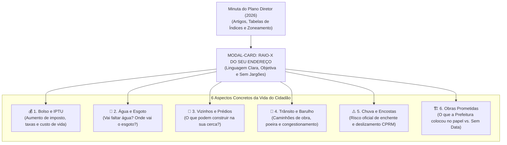

# Metodologia do Raio-X do Cidadão e Auditoria de Obras Prometidas
## Como Traduzir a Minuta do Plano Diretor de São Roque em Impactos Práticos e Transparentes no Cotidiano do Morador

---

### 1. Princípio Metodológico: Da Linguagem Burocrática à Realidade do Cidadão

O cidadão comum não tem a obrigação de dominar jargões como *"outorga onerosa do direito de construir"*, *"coeficiente de aproveitamento básico"* ou *"desafetação de bens dominicais"*. Contudo, ele compreende com clareza imediata os **problemas concretos que afetam sua casa, sua família e seu bolso**.

Para que a investigação científica cumpra sua função social, o sistema do Lakehouse estrutura as minutas das Leis Complementares nº 39 e nº 40/2006 sob uma **matriz de tradução direta** dividida em **6 dimensões do cotidiano**:

---

### 2. O Critério da Justiça e Equilíbrio: Obras Prometidas vs. Efeito Imediato

Para que a análise seja rigorosa, técnica e justa com a administração municipal, o modelo **registra todas as melhorias e obras que o poder público previu nas minutas**:
* Implantação de Parques Lineares (Vila Amaral, Bernardino de Lucca, Estação Ferroviária, Paisagem Colonial);
* Plano do Sistema Viário de Mailasqui e São João Novo;
* Áreas de Especial Interesse Social (regularização de vilas e loteamentos populares);
* Programas de Saneamento Ambiental nos Mananciais do Carmo.

#### O Alerta Realista Necessário (Assimetria Temporal):
O método científico aponta a assimetria fundamental entre a iniciativa pública e a privada:
1. **A Liberação Privada é Imediata**: No dia seguinte à sanção da lei, construtoras e loteadores já podem protocolar projetos de prédios de 7 a 10 andares e condomínios fechados;
2. **A Obra Pública NÃO tem Data**: As melhorias viárias, parques e redes de esgoto dependem de licitação, projeto executivo, dotação no Plano Plurianual (PPA) e recursos orçamentários que **não foram vinculados na lei**. Portanto, o cidadão recebe o impacto do adensamento anos antes (ou sem garantia) de receber a infraestrutura prometida.

---

### 3. Matriz de Impacto das 6 Dimensões nos Principais Bairros (Bolso em 1º Lugar)

| Dimensão do Cotidiano | Centro, Junqueira e Goianã | Bairro do Carmo e Canguera | Mailasqui e São João Novo | Complexo Catarina e Castello |
| :--- | :--- | :--- | :--- | :--- |
| **💰 1. Bolso e IPTU** | IPTU entre os mais caros; pressão de valorização artificial da planta genérica. | Risco iminente de conversão de ITR rural (barato) em IPTU urbano de alto valor e taxa de lixo. | Cobrança de IPTU urbano e taxa de coleta de lixo em ruas e vielas ainda não asfaltadas. | Supervalorização bilionária para incorporador; restrição de altura que onera os vizinhos. |
| **🚰 2. Água e Esgoto** | Rede antiga sobrecarregada; queda de pressão no verão e retorno de esgoto na chuva. | **Risco Crítico**: Sem Sabesp; novos loteamentos disputam nascentes e saturam lençol freático com fossas. | Esgoto ainda corre em fossas e córregos; adensamento sem investimento prévio em ETE. | Sem rede Sabesp; poços artesianos profundos disputam água com córregos vizinhos. |
| **🏢 3. Prédios na sua Cerca** | Prédios de 8 a 10 andares (24m-30m) com TO de até 80%; perda de sol e ventilação. | Condomínios fechados avançando sobre áreas de mata nativa da APA de Itupararanga. | Prédios de 5 a 7 andares (15m-21m) e lotes de 250m² com 70% de concreto no terreno. | Prédios de 10 andares (30m) e até 100m em lote; shopping e galpões corporativos. |
| **🚗 4. Trânsito e Barulho** | Ruas estreitas travadas em horários de pico; falta crônica de vagas de estacionamento. | Estradas rurais de pista simples e terra com tráfego pesado de caminhões de obras. | Filas na Raposo Tavares; travessias perigosas de pedestres e ônibus lotados. | Barulho de jatos executivos pousando e decolando; tráfego de carretas na rodovia. |
| **⚠️ 5. Encostas e Enchentes** | **5 Setores R3 da CPRM**: Goianã, Vinhedos III, Junqueira, Vinhas do Sol e Mosteiro (deslizamento). | **Setor SRQ-18 (Vila do Carmo)**: Risco Alto (R3) de Inundação em chuvas torrenciais. | Alagamentos em várzeas e fundos de vale ao longo da linha férrea e córregos. | Baixo risco de deslizamento, mas grande enxurrada descendo para os córregos de Mailasqui. |
| **🏗️ 6. Obras Prometidas** | Promessa de parques lineares e drenagem, mas aguardando verbas externas sem data. | Promessa de "Parque dos Alagados", sem projeto executivo ou dinheiro reservado. | Promessa de duplicação e parque da estação, sem cronograma de início. | Promessa de obras de mitigação de tráfego, sem vinculação no PPA municipal. |

---

### 4. Diagnóstico Urbanístico: Spot Zoning Explicado ao Cidadão

Em vez de sobrecarregar o cidadão com siglas urbanísticas abstratas (*CA, TO, taxa de permeabilidade, outorga*), o Diagnóstico Urbanístico do Lakehouse traduz o enquadramento do imóvel em termos concretos de **Justiça Territorial vs. Casuísmo**:

1. **Quando há Spot Zoning Detectado (Score $\ge$ 35/100)**:
   * **O que significa na prática**: O morador é alertado de que aquele perímetro recebeu uma regra de exceção feita sob medida para favorecer um grupo econômico específico, autorizando construções muito mais altas (+15m a +85m) e com muito mais concreto do que o permitido aos vizinhos.
   * **Transparência Forense**: Exibe a métrica de *Ilhamento Territorial* (% da divisa com zona diferente) e o *Salto de Altura*.
2. **Quando é Regime Regular da Cidade (Score < 35/100)**:
   * **O que significa na prática**: Confirma que o endereço segue o planejamento sistêmico geral do município, sem privilégios anômalos ou quebras injustificadas do tecido urbano.
3. **Quadro Comparativo Descomplicado**:
   * Substitui os códigos de zona por descrições vivas: *"Casas térreas, chácaras de lazer e mata nativa"* (2006) vs. *"Liberados prédios de até 7 andares com 70% de concreto no terreno"* (2026).

---

### 5. Como o Cidadão Acessa essas Informações no Lakehouse Web

No aplicativo [lakehouse/web/index.html](file:///c:/Users/admin/Desktop/Plano%20Diretor/lakehouse/web/index.html):
1. **Pela Barra de Busca Inferior ("O que muda na sua rua?")**:
   * Motor de busca tolerante a erros de digitação e acentos, com catálogo pré-carregado de mais de 40 locais de São Roque e integração instantânea;
   * O morador digita sua rua ou bairro (ex.: *"Estrada do Carmo"*, *"Rua Álvaro Villaça"*, *"Avenida Brasil"* ou *"Junqueira"*);
   * O sistema localiza o ponto no mapa, faz zoom suave e abre automaticamente o **Modal-Card Completo**.
2. **Pelo Clique Direto no Mapa**:
   * Ao tocar em qualquer bairro, polígono ou setor de *Spot Zoning* no mapa, o card inferior traz o botão:  
     `🔍 Ver Raio-X Completo do seu Bairro`;
   * O modal se expande trazendo todas as 6 dimensões de impacto e os alertas de *Spot Zoning* e risco geológico correspondentes.
3. **Cartografia 100% Livre e Estável**:
   * O mapa utiliza a camada **Esri World Dark Gray Canvas**, eliminando qualquer exigência de chaves de API, marcas d'água ou bloqueios de CORS, funcionando nativamente via arquivo local ou hospedagem web.
