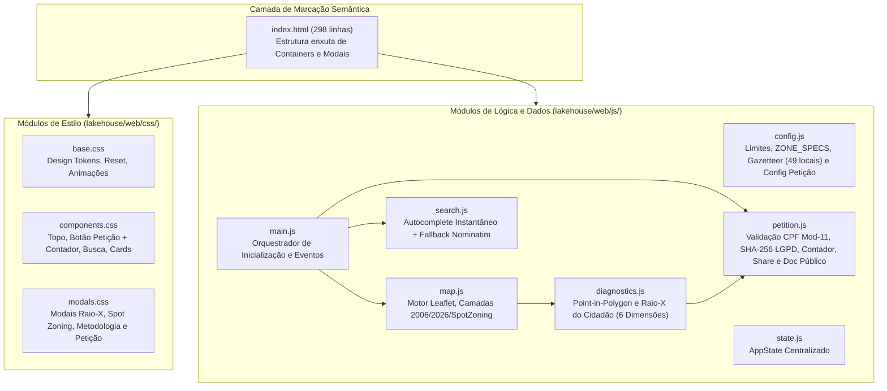

# Refatoração Modular, Publicação no GitHub Pages e Petição Pública Criptografada
## Engenharia de Desacoplamento de Frontend e Arquitetura Serverless de Mobilização Cidadã ("Crescer exige responsabilidade!")

---

### 1. Diagnóstico do Monolito e Arquitetura de Refatoração

O arquivo `lakehouse/web/index.html` havia atingido **2.062 linhas (~101 KB)**, condensando estilos CSS, marcação HTML, dicionários geoespaciais, lógica de renderização Leaflet, motor de busca e diagnósticos das 6 dimensões do cidadão em um único arquivo.

Para garantir **manutenibilidade, isolamento de responsabilidades (SoC)** e **compatibilidade dupla** — funcionando tanto via duplo clique local (`file://` sem erros de CORS) quanto publicado via HTTPS no **GitHub Pages** — o sistema foi desacoplado em **11 módulos especializados**:

---

### 2. Publicação Moderna no GitHub Pages (GitHub Actions `deploy-pages@v4`)

A forma mais moderna de operar o GitHub Pages dispensa branches dedicadas (`gh-pages`) ou pastas duplicadas (`/docs`), utilizando o pipeline oficial de artefatos via **GitHub Actions**:

1. **Workflow Automatizado (`.github/workflows/deploy-pages.yml`)**:
   * Acionado a cada `git push` na branch `main` (ou manualmente via `workflow_dispatch`);
   * Faz checkout com suporte ao **Git LFS** (`lfs: true`);
   * Empacota exclusivamente o diretório `lakehouse/web` como raiz do site usando `actions/upload-pages-artifact@v3`;
   * Publica diretamente na CDN global do GitHub via `actions/deploy-pages@v4`.
2. **Bypass do Jekyll (`lakehouse/web/.nojekyll`)**:
   * Garante publicação imediata dos ativos estáticos e arquivos `.js`/`.geojson` sem interferência do processador Ruby/Jekyll.

---

### 3. Engenharia da Petição Online: `> Crescer exige responsabilidade!`

Todos os botões que antes apontavam estaticamente para a Lei de Acesso à Informação foram substituídos pelo botão interativo **`> Crescer exige responsabilidade!`** integrado a um **contador dinâmico em tempo real**.

#### 3.1. Validação Matemática de CPF (Algoritmo Módulo-11 da Receita Federal)
Antes de somar qualquer assinatura ao contador, o módulo `js/petition.js` executa a verificação oficial dos dois dígitos verificadores ($D_1$ e $D_2$):
$$D_1 = 11 - \left( \sum_{i=1}^{9} \text{CPF}_i \cdot (11 - i) \pmod{11} \right)$$
$$D_2 = 11 - \left( \sum_{i=1}^{10} \text{CPF}_i \cdot (12 - i) \pmod{11} \right)$$
* Sequências inválidas ou repetidas (`111.111.111-11`, etc.) são bloqueadas instantaneamente no formulário com feedback visual em tempo real (`✓ CPF Válido` / `✗ CPF Inválido`).

#### 3.2. Proteção Criptográfica SHA-256 e Conformidade com a LGPD (Lei nº 13.709/2018)
Como repositórios do GitHub Pages são públicos, **nenhum CPF bruto é exposto em texto aberto**:
1. **Mascaramento Oficial**: O documento exibe apenas o formato padrão do CNJ e Portais da Transparência (`***.456.789-**`);
2. **Impressão Digital Criptográfica Inalterável**: A API nativa `window.crypto.subtle.digest('SHA-256', ...)` gera um hash único com *salt* (`SHA256("SRQ_PD_2026_SALT::" + CPF)`), que impede assinaturas duplicadas pelo mesmo CPF e gera um código de protocolo auditável (`SRQ-2026-XXXXXXXX`).

#### 3.3. Compartilhamento Viral e Composição do Documento Público Posterior
Após assinar e incrementar o contador (`+1`):
* **Compartilhamento**: Botões diretos para **WhatsApp** (com mensagem pré-formatada contendo o número atualizado de assinaturas e link), **Web Share API nativa** (mobile) e **Cópia de Link**;
* **Compositor de Documento Público Oficial (`openPublicDocumentWindow`)**: Gera dinamicamente o **Instrumento Público de Petição e Representação Cidadã**, endereçado à Presidência da Câmara Municipal de São Roque e à Promotoria de Justiça do MPSP, fundamentado no Art. 5º, XXXIV, "a" da CF/88 e no Estatuto da Cidade, contendo as 4 exigências técnicas do Lakehouse e a tabela auditável de subscritores com Nome, Bairro, Vínculo, CPF Mascarado e Hash SHA-256, pronto para impressão ou exportação em PDF (`window.print()`).
