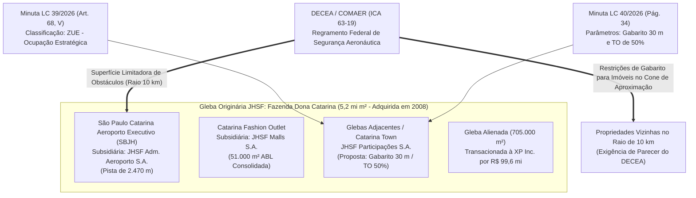

# Dossiê Emblemático 01: Análise Urbanística e Regulatória do Complexo Catarina (JHSF)
## Unicidade Dominial da Gleba Originária, Evolução dos Parâmetros Urbanísticos e Condicionantes Aeronáuticas (2008–2026)

---

### 1. Resumo Executivo e Enquadramento Epistêmico

O Complexo Catarina compreende uma expressiva operação imobiliária e de infraestrutura às margens da Rodovia Castello Branco (km 60 a 62). A análise pericial e imobiliária comprova que o aeródromo executivo privado (**SBJH – São Paulo Catarina Aeroporto Executivo**) e as áreas destinadas a desenvolvimento imobiliário e comercial (**Catarina Fashion Outlet** e o planejado **Catarina Town**) originam-se da **mesma gleba contígua de 5,2 milhões de m² (520 hectares)** da antiga Fazenda Dona Catarina, adquirida em novembro de 2008 pelo grupo econômico **JHSF Participações S.A.**.

A revisão do marco urbanístico municipal (Minutas das Leis Complementares nº 39 e nº 40 de 2026) suscita debates técnicos sobre a compatibilidade entre os incentivos ao desenvolvimento econômico regional e a capacidade de suporte da infraestrutura local, além de assimetrias regulatórias frente ao zoneamento do entorno.

---

### 2. A Cadeia de Fatos Relevantes na CVM: Cronologia e Valores Oficiais

A evolução das transações e do enquadramento urbanístico encontra-se documentada nos Fatos Relevantes e comunicados oficiais protocolados pela JHSF Participações S.A. perante a Comissão de Valores Mobiliários (CVM):

| Data do Comunicado CVM | Título Oficial do Fato Relevante | Gleba / Área Envolvida | Valor da Transação / Investimento | Enquadramento Factual | Nível Epistêmico |
| :--- | :--- | :--- | :--- | :--- | :--- |
| **20/11/2008** | **Aquisição Originária na Rodovia Castello Branco** | **5.200.000 m² (520 ha)** (Fazenda Dona Catarina) | **R$ 42.500.000,00** | Aquisição de imóvel rural pelo valor histórico de R$ 8,17/m². | **Nível 1** (Documental Pleno) |
| **21/12/2012** | **Aprovação da ZUCAer (LC nº 66/2012)** | 5.200.000 m² | Enquadramento Regulatório | Sanção da Lei Complementar nº 66/2012 pelo Executivo Municipal, instituindo a Zona de Urbanização Específica do Aeródromo. | **Nível 1** (Documental Pleno) |
| **22/03/2013** | **Autorização Federal para Aeródromo Privado** | 5.200.000 m² | R$ 500.000.000,00 (CAPEX Estimado) | Portaria nº 97/2013 da SAC/PR e autorização da ANAC para exploração de aeródromo civil público com gestão privada. | **Nível 1** (Documental Pleno) |
| **24/10/2014** | **Inauguração do Catarina Fashion Outlet** | 150.000 m² (Terreno) | R$ 102.000.000,00 | Instalação de polo comercial lindeiro à rodovia. | **Nível 1** (Documental Pleno) |
| **16/12/2019** | **Início das Operações do Aeroporto Executivo** | 5.200.000 m² | R$ 600.000.000,00 (Consolidado) | Homologação da pista para tráfego executivo doméstico e posterior internacionalização. | **Nível 1** (Documental Pleno) |
| **13/07/2020** | **Alienação de Parcela à XP Inc.** | **705.000 m² (13,5% da gleba originária)** | **R$ 99.600.000,00** | Transação imobiliária privada entre sociedades de capital aberto (valor de R$ 141,27/m²). | **Nível 1** (Documental Pleno) |
| **2024** | **Parceria Tripartite XP Malls / Expansão III** | 51.000 m² ABL | R$ 443.000.000,00 | Expansão de área locável comercial no corredor da rodovia. | **Nível 1** (Documental Pleno) |
| **2026 (Minutas)** | **Revisão do Plano Diretor (LCs 39 e 40)** | Área Remanescente (> 4,3 mi m²) | Parâmetros Urbanísticos Propostos | Proposta de enquadramento em ZUE – Ocupação Estratégica, com Gabarito de 30 m e TO de 50%. | **Nível 2** (Antinomia Técnica) |

---

### 3. Análise Bilateral e Princípio do Contraditório

#### 3.1. Justificativa Oficial e Posição do Empreendedor
- **Desenvolvimento Econômico Regional**: A instalação do complexo aeroportuário e comercial atrai investimentos de grande porte, consolidando São Roque como polo de aviação corporativa na América Latina e centro de comércio de alta densidade.
- **Geração de Emprego e Renda**: O empreendimento gera milhares de postos de trabalho diretos e indiretos, desde a construção civil até o setor de serviços, hotelaria e aviação executiva.
- **Arrecadação Tributária**: O complexo incrementa a arrecadação de Imposto Sobre Serviços de Qualquer Natureza (ISSQN) sobre operações aeroportuárias, hangaragem e manutenção de aeronaves, além do repasse de ICMS derivado das vendas do polo de varejo.

#### 3.2. Apontamentos Críticos e Fragilidades Urbanístico-Ambientais
- **Assimetria de Parâmetros Urbanísticos**: Enquanto a Minuta da LC 40/2026 (pág. 34) prevê para as áreas da ZUE Gabarito de 30 metros (10 pavimentos) e Taxa de Ocupação de 50%, as áreas periurbanas e rurais lindeiras do município mantêm parâmetros consideravelmente mais restritivos.
- **Origem Federal da Tutela Aeronáutica vs. Percepção Urbanística Local**:
  - A restrição a edificações no raio de 10 km em torno do aeródromo (objeto do § 1º, pág. 23 da Minuta da LC 39) decorre do **Plano Básico de Zona de Proteção de Aeródromos (PBZPA)**, regulamentado em nível federal pelo Departamento de Controle do Espaço Aéreo (DECEA, Portaria DECEA nº 176/DGCEA/2021 e ICA 63-19) e ANAC. Trata-se de exigência de segurança de navegação aérea que independe da vontade da legislação municipal.
  - Todavia, a convivência entre restrições federais de gabarito para proprietários lindeiros inseridos no cone de aproximação e a permissão municipal de verticalização de 30 metros nas glebas do próprio complexo demanda rigorosa modelagem tridimensional de obstáculos para afastar conflitos operacionais e assimetrias de potencial construtivo.
- **Infraestrutura de Saneamento e Recursos Hídricos**: O adensamento residencial e corporativo projetado para o *Catarina Town* não possui ligação à rede coletora pública de esgoto da concessionária (SABESP). O licenciamento e a ampliação da infraestrutura demandam comprovação rigorosa da eficiência de estações próprias de tratamento de efluentes (ETE) e outorgas de captação hídrica junto ao DAEE/CETESB para evitar sobrecarga sobre a sub-bacia do Rio Maylasky/Médio Tietê.
- **Regime da Outorga Onerosa (OODC)**: A Minuta da LC 39 (Art. 43) estabelece que a fórmula de cálculo da contrapartida financeira do direito de construir será regulamentada por lei municipal ordinária em até 1 ano após a promulgação do Plano Diretor. A ausência da fórmula no próprio corpo da lei complementar gera controvérsia jurídica em face do art. 30 da Lei Federal nº 10.257/2001 (Estatuto da Cidade).

---

### 4. Fontes Primárias e Custódia Documental

Todos os atos normativos e certidões referenciados estão custodiados com hash de integridade imutável:
- **Minuta da Lei Complementar nº 39/2006 (65 páginas)**: `06_DOCUMENTOS_OFICIAIS_FONTES_PRIMARIAS_PDFS/01_MINUTAS_PLANO_DIRETOR_2026/01_Minuta_LC_39_2006_Plano_Diretor_Estrategico_65_Pags.pdf` *(SHA-256: `8721fdcd7a7d...`)*
- **Minuta da Lei Complementar nº 40/2006 (62 páginas)**: `06_DOCUMENTOS_OFICIAIS_FONTES_PRIMARIAS_PDFS/01_MINUTAS_PLANO_DIRETOR_2026/02_Minuta_LC_40_2006_Zoneamento_Uso_Ocupacao_62_Pags.pdf` *(SHA-256: `f1a218044454...`)*
- **Texto Integral da Lei Complementar nº 66/2012 (ZUCAer)**: `06_DOCUMENTOS_OFICIAIS_FONTES_PRIMARIAS_PDFS/04_LEGISLACAO_MUNICIPAL_HISTORICA_SIAVE/SIAVE_LC_66_2012_Criacao_ZUCAer_Complexo_Catarina_Texto_Integral.pdf` *(SHA-256: `0da29b3e6601...`)*
- **Compensação Ambiental CETESB / DOESP**: `06_DOCUMENTOS_OFICIAIS_FONTES_PRIMARIAS_PDFS/05_LICENCIAMENTO_AMBIENTAL_E_CONTRATOS/CETESB_DOESP_Licencas_Compensacao_Aeroporto_Catarina_JHSF.pdf` *(SHA-256: `ea8c80d515a9...`)*
