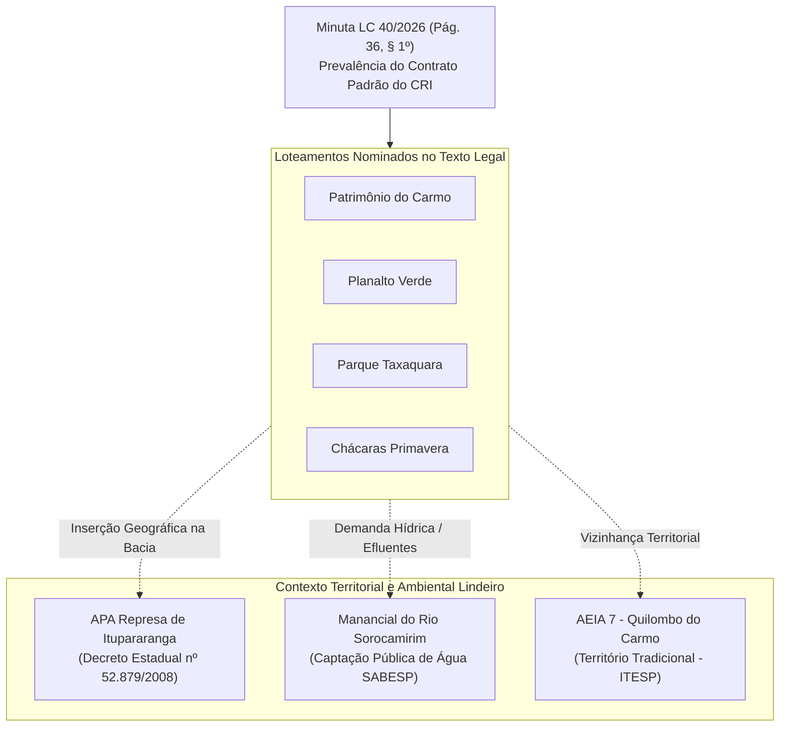

# Dossiê Emblemático 03: Regime Jurídico de Parcelamento no Bairro do Carmo, Mananciais do Rio Sorocamirim e Território Quilombola
## Análise da Redação do § 1º da Minuta da LC 40/2006, APA de Itupararanga e Zona de Amortecimento da AEIA 7

---

### 1. Resumo Executivo e Enquadramento Epistêmico

O exame comparativo das minutas de revisão do Plano Diretor de São Roque (Minutas das Leis Complementares nº 39 e nº 40 de 2026) evidencia uma particularidade redacional no capítulo de parcelamento do solo: a inserção, na Minuta da LC 40/2006 (Pág. 36, § 1º), de menção expressa a quatro empreendimentos imobiliários específicos no Bairro do Carmo e adjacências, estabelecendo a prevalência dos contratos padrões registrados em cartório sobre os parâmetros gerais municipais.

A região envolvida abriga áreas ambientalmente sensíveis: a **Área de Proteção Ambiental (APA) da Represa de Itupararanga** (Lei Estadual nº 11.579/2003 e Decreto Estadual nº 52.879/2008), os mananciais de abastecimento público do **Rio Sorocamirim** e a **AEIA 7 – Quilombo do Carmo** (território tradicional certificado pela Fundação Itesp).

---

### 2. A Disposição Textual na Minuta da LC nº 40/2006

Na página 36 da Minuta para Revisão da Lei Complementar nº 40/2006 (`01_MINUTAS_PLANO_DIRETOR_2026/02_Minuta_LC_40_2006_Zoneamento_Uso_Ocupacao_62_Pags.pdf`), consta a seguinte redação:

> *"§ 1º Nos Loteamentos denominados **'Planalto Verde'**, **'Parque Taxaquara'**, **'Chácaras Primavera'** e **'Patrimônio do Carmo'**, prevalecerão os lotes mínimos determinados pelo Contrato Padrão do Loteamento e/ou pelo registro no Cartório de Registro de Imóveis de São Roque."*

#### Enquadramento Dogmático e Nível Epistêmico:
- **Nível 1 (Fato Documental Pleno)**: A existência literal do texto da minuta com citação nominal de quatro condomínios é incontestável.
- **Análise Técnico-Jurídica**:
  1. **Princípio da Generalidade e Abstração**: A técnica legislativa recomenda que normas urbanísticas gerais estabeleçam critérios objetivos (ex.: zonas geográficas, faixas de declividade, disponibilidade de rede pública), e não menções ad hominem a empreendimentos específicos.
  2. **Interpretação do Contrato Padrão (Bilateralidade)**:
     - *Vertente Conservacionista/Condominial*: Historicamente, contratos padrões de loteamentos residenciais fechados de alto padrão (como o Patrimônio do Carmo) fixavam **lotes mínimos expressivos** (1.000 m² a 3.000 m² ou mais) e restrições construtivas rígidas. Sob essa perspectiva, a menção ao contrato padrão pode ter por finalidade **impedir o desdobro dos lotes em metragens inferiores**, preservando o perfil de baixíssima densidade do enclave.
     - *Vertente Urbanística/Estatuto da Cidade*: Sob a ótica do direito público, a subordinação de parâmetros municipais a contratos particulares arquivados em cartório suscita dúvidas quanto à hierarquia das fontes normativas, podendo limitar a incidência de diretrizes públicas atualizadas sobre áreas comuns, vias de circulação e destinação de áreas públicas.

---

### 3. Vulnerabilidade Hídrica e Relações de Vizinhança

1. **Bacia Hidrográfica do Rio Sorocamirim**:
   - O Rio Sorocamirim é manancial essencial para o abastecimento público urbano de São Roque e integra a bacia formadora do Reservatório de Itupararanga.
   - Qualquer ocupação intensiva, seja por chacreamento informal ou por condomínios de médio/alto padrão, deve observar as diretrizes do **Plano de Manejo da APA de Itupararanga** (Decreto Estadual nº 52.879/2008), em especial quanto ao tratamento terciário de efluentes sanitários, sob pena de risco de eutrofização dos corpos hídricos.
2. **Adjacência com a AEIA 7 (Quilombo do Carmo)**:
   - A comunidade tradicional do Quilombo do Carmo possui delimitação reconhecida pela Fundação Itesp.
   - A expansão do vetor imobiliário de lazer e chácaras no Bairro do Carmo exerce pressão econômica e fundiária na região periurbana. O ordenamento do território demanda Estudos de Impacto de Vizinhança (EIV) que considerem as especificidades socioculturais e a proteção da agricultura familiar tradicional dos remanescentes quilombolas.
   - **Enquadramento Epistêmico**: **Nível 3 (Hipótese de Impacto Territorial)**. Não constam nos autos judiciais registros de litígio possessório direto entre o condomínio formal e a comunidade tradicional; o impacto reside na dinâmica imobiliária e de valoração tributária regional.

---

### 4. Fontes Primárias e Custódia Documental

- **Minuta da Lei Complementar nº 40/2006 (Texto da Pág. 36)**: `06_DOCUMENTOS_OFICIAIS_FONTES_PRIMARIAS_PDFS/01_MINUTAS_PLANO_DIRETOR_2026/02_Minuta_LC_40_2006_Zoneamento_Uso_Ocupacao_62_Pags.pdf` *(SHA-256: `f1a218044454...`)*
- **Lei Estadual nº 11.579/2003 (Criação da APA Itupararanga)**: `06_DOCUMENTOS_OFICIAIS_FONTES_PRIMARIAS_PDFS/05_LICENCIAMENTO_AMBIENTAL_E_CONTRATOS/ALESP_Lei_Estadual_11579_2003_Criacao_APA_Itupararanga.pdf` *(SHA-256: `674803e394ed...`)*
