# Dossiê Emblemático 05: Governança do Planejamento Territorial, Contratações em Geotecnologias e Participação Social
## Auditoria de Contratos Administrativos, Inquéritos Civis em Tramitação no MPSP e Avaliação das Contribuições na Consulta Pública do Plano Diretor

---

### 1. Resumo Executivo e Enquadramento Epistêmico

Este dossiê pericial analisa a governança técnica e institucional que subsidiou a revisão do Plano Diretor de São Roque (Minutas das Leis Complementares nº 39 e nº 40 de 2026), com base em dados primários do Diário Oficial do Estado de São Paulo (DOESP), do Tribunal de Justiça de São Paulo (TJ-SP), do Ministério Público do Estado de São Paulo (MPSP), do Tribunal Superior Eleitoral (TSE) e do GRAPROHAB.

A análise estrutura-se em três eixos de apuração:
1. **Eixo Contratual e Procedimental**: A contratação de serviços técnicos especializados de geoprocessamento e redação urbanística, e a instauração de inquérito civil no MPSP.
2. **Eixo Institucional e Relações Processuais**: O histórico de doações eleitorais declaradas, a tramitação de Ação Direta de Inconstitucionalidade proposta pelo Procurador-Geral de Justiça e os registros do GRAPROHAB.
3. **Eixo da Participação Popular**: O exame do tratamento conferido pelo Departamento de Planejamento e Meio Ambiente (DPMA) às manifestações da Consulta Pública, contrastando demandas de entidades setoriais e órgãos colegiados de controle ambiental.

```mermaid
graph TD
    subgraph EIXO_1 ["Eixo 1: Contratações Técnicas e Procedimentos do MPSP"]
        DPMA["Departamento de Planejamento e Meio Ambiente (DPMA)<br>Dir. Juliana Egydio Caldevilla Bonfietti"]
        GEO["Geo Pixel Geotecnologias / SCP Geosistemas<br>Contratos somando R$ 1,47 Milhão (2023-2024)"]
        OLIVER["Oliver Arquitetura Ltda. - EPP<br>Pregão 084/2022 (R$ 200 mil) suspenso pelo TJ-SP"]
        INQ_MP["MPSP Inquérito Civil nº 0439.0000192/2025<br>Apuração em Andamento: Probidade Administrativa<br>(Prefeito, Primeira-Dama, Dir. DPMA e Geo Pixel)"]
        DPMA -->|"Contratação de Base Cartográfica / SIG"| GEO
        DPMA -->|"Contratação de Consultoria Urbanística"| OLIVER
        INQ_MP -.->|"Objeto da Apuração"| DPMA
        INQ_MP -.->|"Objeto da Apuração"| GEO
    end

    subgraph EIXO_2 ["Eixo 2: Relações Institucionais e Registros Oficiais"]
        DOADOR["Osmar Henrique Villaça Boccato<br>(Doador Declarado no TSE: R$ 62.670)"]
        PREFEITO["Marcos Augusto Issa Henriques de Araújo<br>(Prefeito Municipal)"]
        PRES_CAMARA["Rafael Tanzi de Araújo<br>(Vereador / Ex-Pres. da Câmara)"]
        ADIN_PGJ["TJ-SP ADIN nº 2191432-40.2024.8.26.0000<br>Proc. MPSP nº 0466.0000486/2024 (PGJ Autor)<br>Partes Arroladas por Dever Processual"]
        LOTE_BOCCATO["Loteamento Villaggio Boccato<br>Crisdoda Empreendimentos (GRAPROHAB 17.841)<br>Certificado 002/2024 cancelado a pedido em 2026"]
        DOADOR -->|"Doação de Campanha Declarada"| PREFEITO
        ADIN_PGJ -.->|"Arrolados nos Autos"| PREFEITO
        ADIN_PGJ -.->|"Arrolados nos Autos"| PRES_CAMARA
        ADIN_PGJ -.->|"Arrolados nos Autos"| DOADOR
        DOADOR -.->|"Quadro Societário / Empreendimento"| LOTE_BOCCATO
    end

    subgraph EIXO_3 ["Eixo 3: Tratamento de Manifestações na Consulta Pública"]
        CRECI["Roque Gonçalves (Delegado CRECISP)<br>Interlocução Técnica DPMA (Eng. David Berger)"]
        PROP_57["Sugestão nº 57: Conversão de 108.000 m²<br>Solo Rural/INCRA -> ZUR-md (Estrada do Candor)"]
        COMDEMA["COMDEMA (Conselho Municipal de Meio Ambiente)<br>Sugestão nº 03: Sobreposição com PDA 2019 e APA"]
        DECISAO_CRECI["DECISÃO DPMA: ACATADA<br>(Justificativa: Demanda Histórica)"]
        DECISAO_COMDEMA["DECISÃO DPMA: POSTERGADA<br>(Justificativa: Fase de Diretrizes Gerais)"]
        CRECI --> PROP_57 --> DECISAO_CRECI
        COMDEMA --> DECISAO_COMDEMA
    end
```

---

### 2. Eixo 1: A Contratação da Base Territorial e os Procedimentos Ministeriais

#### 2.1. O Inquérito Civil MPSP nº 0439.0000192/2025
Conforme publicações no Diário Oficial do Estado de São Paulo (Caderno Executivo, Seção Ministério Público, DOE de 03/07/2025, DOE de 06/10/2026 e DOE de 08/10/2026), a Promotoria de Justiça de São Roque instaurou procedimento de tutela do patrimônio público:
- **Número do Procedimento**: `Inquérito Civil nº 0439.0000192/2025`
- **Objeto**: `Direito Administrativo > Atos Administrativos > Improbidade Administrativa > Enriquecimento Ilícito e Dano ao Erário (Código 10013)`
- **Representante / Noticiante**: Guilherme Macedo Pascal
- **Representados / Investigados**:
  1. Marcos Augusto Issa Henriques de Araújo (Prefeito)
  2. Marina Villaça Issa de Araújo (Primeira-Dama)
  3. Juliana Egydio Caldevilla Bonfietti (Diretora do DPMA)
  4. Pixel Geotecnologias Consultoria e Serviço Ltda. - SCP Geosistemas
- **Nível Epistêmico**: **Nível 1** (Fato Notório Documental Pleno).
- **Ressalva Pericial Neutra**: A instauração de inquérito civil é procedimento de natureza investigatória e inquisitorial prévia, destinado a colher elementos de convicção pelo Parquet. Não constitui condenação judicial transitada em julgado e é regido pelo postulado constitucional da presunção de inocência.

#### 2.2. O Histórico de Contratos Administrativos com a Geo Pixel
Os extratos publicados no DOESP comprovam as contratações para manutenção do sistema de geoprocessamento e base cadastral do município:
- **Contrato nº 138/2023** (Assinatura: 05/12/2023, DOE 12/12/2023): Valor de **R$ 628.920,00** (vigência de 12 meses) para "transferência tecnológica, treinamento e atendimento ao usuário em geotecnologias".
- **Contrato / Aditivo nº 139/2023** (Assinatura: 19/12/2023, DOE 08/01/2024): Valor de **R$ 89.500,00**.
- **Contrato / Prorrogação nº 142/2024** (Assinatura: 03/12/2024, DOE 05/12/2024): Valor de **R$ 752.616,72** (vigência de 12 meses).
- **Volume Total Contratado**: **R$ 1.471.036,72**.
- **Nível Epistêmico**: **Nível 1** (Fato Documental Pleno).

#### 2.3. O Pregão Presencial nº 084/2022 (Oliver Arquitetura) e Judicialização
Para a redação da minuta urbanística originária, a Prefeitura homologou o **Pregão Presencial nº 084/2022 (Processo Administrativo nº 167/2022)** com a empresa **Oliver Arquitetura Ltda. - EPP** (CNPJ `07.273.779/0001-68`), no montante de R$ 200.000,00.
- A contratação foi objeto da **Ação Popular nº 1003444-84.2023.8.26.0586** perante a Vara Judicial da Comarca de São Roque, tendo o juízo deferido medida liminar para suspender os efeitos do contrato em virtude de questionamentos sobre a modalidade licitatória (uso de pregão para serviço técnico profissional especializado de natureza intelectual).
- Na Consulta Pública do Plano Diretor (Sugestão Popular nº 8), munícipes solicitaram a revisão independente dos relatórios preliminares, tendo a administração municipal informado que o processo passou por reestruturação interna e reinício das etapas técnicas pelo DPMA.
- **Nível Epistêmico**: **Nível 1** (Processo Judicial e Consulta Pública Documentados).

---

### 3. Eixo 2: Relações Institucionais e Registros Oficiais

#### 3.1. Dados Oficiais de Doações Eleitorais (TSE)
A base oficial de prestação de contas do TSE atesta que o empresário **Osmar Henrique Villaça Boccato** efetuou doações eleitorais declaradas:
- **Eleições 2020**: R$ 30.670,00 (em 6 depósitos bancários).
- **Eleições 2024**: R$ 32.000,00 (sendo R$ 30.000,00 via transferências e R$ 2.000,00 como cessão de veículo Toyota Hilux).
- **Consolidado**: R$ 62.670,00, correspondendo ao maior doador individual pessoa física para a candidatura do mandatário.
- **Nível Epistêmico**: **Nível 1** (Registro Público do TSE).

#### 3.2. A ADIN do Procurador-Geral de Justiça (TJ-SP nº 2191432-40.2024.8.26.0000)
O Procurador-Geral de Justiça ajuizou a **Ação Direta de Inconstitucionalidade nº 2191432-40.2024.8.26.0000** perante o Órgão Especial do TJ-SP (Proc. MP nº `0466.0000486/2024`, ajuizado em 29/06/2024, publicado no DOESP em 12/09/2024):
- **Autor**: Procurador-Geral de Justiça do Estado de São Paulo.
- **Partes Arroladas**: O Prefeito Municipal, o então Presidente da Câmara e o empresário Osmar Henrique Boccato figuram nos autos processuais.
- **Enquadramento Pericial Neutro**: A indicação de autoridades e terceiros juridicamente interessados em sede de controle abstrato de constitucionalidade é decorrência da sistemática da Lei Federal nº 9.868/1999 e do Regimento Interno do TJ-SP para assegurar ampla defesa e o contraditório das partes afetadas pela norma impugnada. O arrolamento formal não equivale a indiciamento criminal nem a imputação subjetiva de conluio.
- **Nível Epistêmico**: **Nível 1** (Autos Judiciais Públicos).

#### 3.3. O Trâmite do Loteamento "Villaggio Boccato" no GRAPROHAB
As atas públicas do GRAPROHAB registram a evolução do projeto habitacional:
- **Protocolo GRAPROHAB**: `17.841` | Empreendimento: Loteamento **"Villaggio Boccato"**.
- **Interessada**: Crisdoda Empreendimentos Imobiliários Ltda.
- **Histórico**:
  - Em 30/01/2024 (01ª Sessão Ordinária, DOE 30/01/2024), o colegiado emitiu o **Certificado de Aprovação nº 002/2024**.
  - Em 15/09/2026 (Ata nº 34 da 34ª Sessão Ordinária, DOE 30/09/2026), mediante o Processo SEI `013.00005388/2026-61`, o Protocolo 17.841 e o Certificado 002/2024 foram **cancelados por solicitação expressa da própria empresa requerente**.
- **Nível Epistêmico**: **Nível 1** (Publicação Oficial no DOESP).

---

### 4. Eixo 3: Tratamento de Manifestações na Consulta Pública do Plano Diretor

A auditoria das 110 sugestões registradas no caderno de participação popular da revisão do Plano Diretor evidencia diferenças nos encaminhamentos técnicos proferidos pelo órgão de planejamento:

| Proponente / Entidade | Sugestão / Demanda | Contexto Registrado | Despacho Técnico do DPMA | Nível Epistêmico |
| :--- | :--- | :--- | :--- | :--- |
| **Roque Gonçalves** (Delegado CRECISP) | **Sugestão nº 57**: Rezoneamento de **108.000 m²** rurais/INCRA na Estrada do Candor para **ZUR-md** (Zona Urbana Residencial de Média Densidade). | O registro formal consigna: *"Por meio de conversa com o David Berger..."* (Engenheiro e Diretor Técnico do DPMA). | **ACATADA**, sob o fundamento de que a demanda de expansão era histórica (desde 2018). | **Nível 1** (Ata da Consulta Pública) |
| **David de Mello Berger** (Engenheiro DPMA) | O servidor atuava em função técnica no órgão municipal e figurava simultaneamente no quadro societário da empresa **Qualiproj Engenharia Ltda.** (CNPJ `43.998.742/0001-60`). | Atuação simultânea em consultoria técnica de projetos civis e exercício de função pública decisória no planejamento municipal. | Matéria não submetida a parecer prévio da Comissão de Ética municipal para fins do Art. 11 da Lei nº 8.429/1992 e princípios de segregação de funções. | **Nível 3** (Hipótese de Conflito de Interesses Funcional) |
| **COMDEMA** (Conselho Municipal de Defesa do Meio Ambiente) | **Sugestão nº 03**: Exigência de apresentação de **mapa comparativo de sobreposição** com o **Plano Diretor Ambiental (PDA 2019 / FEHIDRO)** e com o zoneamento da **APA de Itupararanga**. | Requerimento institucional de colegiado paritário de controle ambiental municipal (Lei nº 5.143). | **POSTERGADA**, com a justificativa de que a fase de audiências públicas destinava-se apenas à fixação de "diretrizes gerais". | **Nível 1** (Ata da Consulta Pública) |
| **Controle Social / Munícipe** | **Sugestão nº 08**: Requerimento de auditoria externa e reexame das minutas originárias da Oliver Arquitetura. | Manifestação de cidadão visando expurgar eventuais vícios do pregão suspenso judicialmente. | **RESPOSTA PROCEDIMENTAL**, informando o reinício formal dos trabalhos internos pelo corpo técnico da Prefeitura em novembro de 2024. | **Nível 1** (Ata da Consulta Pública) |

#### Análise Técnica da Participação Popular:
- **Vertente da Gestão Municipal**: Em processos de planejamento urbano, o diálogo entre o corpo técnico e representantes setoriais (mercado imobiliário, corretores, sindicatos) é praxe para dimensionar vetores de expansão urbana. A decisão de acolher pedidos de rezoneamento baseia-se na compatibilidade com as redes viárias existentes.
- **Vertente de Integridade e Gestão Democrática (Estatuto da Cidade, art. 40)**:
  - O acolhimento sumário de pleito imobiliário individual formulado com base em interlocuções diretas com servidor técnico, em contraposição à postergação do pedido formal do órgão colegiado de meio ambiente (COMDEMA) para apresentação de mapas de vulnerabilidade hídrica, revela fragilidade na isonomia dos critérios de análise.
  - A gestão urbana participativa exige tratamento simétrico de todas as contribuições, com justificação técnica circunstanciada e suporte em estudos de capacidade hídrica e viária antes da transformação de solo rural em urbano.

---

### 5. Fontes Primárias e Custódia Documental

Todos os arquivos estão preservados no diretório oficial de custódia com hash SHA-256:
- **Publicações do Inquérito Civil MPSP nº 0439.0000192/2025 (DOESP)**:
  - `06_DOCUMENTOS_OFICIAIS_FONTES_PRIMARIAS_PDFS/06_DIARIOS_OFICIAIS_E_PRESTACAO_CONTAS/DOESP_2025_07_03_Inquerito_MPSP_0439_2025_Enriquecimento_Ilicito.pdf` *(SHA-256: `745684e35989...`)*
  - `06_DOCUMENTOS_OFICIAIS_FONTES_PRIMARIAS_PDFS/06_DIARIOS_OFICIAIS_E_PRESTACAO_CONTAS/DOESP_2026_10_06_Aviso_403_2026_CSMP_Inquerito_0439_2025.pdf` *(SHA-256: `d317c71ccfac...`)*
  - `06_DOCUMENTOS_OFICIAIS_FONTES_PRIMARIAS_PDFS/06_DIARIOS_OFICIAIS_E_PRESTACAO_CONTAS/DOESP_2026_10_08_Relatorio_Semanal_MPSP_Inquerito_0439_2025.pdf` *(SHA-256: `ae7c3af9a783...`)*
- **ADIN da PGJ nº 2191432-40.2024 (TJ-SP / DOESP)**:
  - `06_DOCUMENTOS_OFICIAIS_FONTES_PRIMARIAS_PDFS/02_DECISOES_JUDICIAIS_TJSP/DOESP_2024_09_12_ADIN_TJSP_2191432_PGJ_Guto_Issa_Rafael_Tanzi_Osmar_Boccato.pdf` *(SHA-256: `96d2dfdb5d34...`)*
- **Contratos da Prefeitura com a Geo Pixel Geotecnologias (DOESP)**:
  - `06_DOCUMENTOS_OFICIAIS_FONTES_PRIMARIAS_PDFS/05_LICENCIAMENTO_AMBIENTAL_E_CONTRATOS/DOESP_2023_12_12_Extrato_Contrato_138_2023_Geo_Pixel_Geotecnologias_628mil.pdf` *(SHA-256: `1a525a6a4f40...`)*
  - `06_DOCUMENTOS_OFICIAIS_FONTES_PRIMARIAS_PDFS/05_LICENCIAMENTO_AMBIENTAL_E_CONTRATOS/DOESP_2024_12_05_Extrato_Contrato_142_2024_Geo_Pixel_Geotecnologias_752mil.pdf` *(SHA-256: `20a2725a6596...`)*
- **Decisões do GRAPROHAB sobre o Loteamento Villaggio Boccato (DOESP)**:
  - `06_DOCUMENTOS_OFICIAIS_FONTES_PRIMARIAS_PDFS/05_LICENCIAMENTO_AMBIENTAL_E_CONTRATOS/DOESP_2024_01_30_GRAPROHAB_Ata_01SO_Certificado_002_2024_Loteamento_Villaggio_Boccato.pdf` *(SHA-256: `59480454424d...`)*
  - `06_DOCUMENTOS_OFICIAIS_FONTES_PRIMARIAS_PDFS/05_LICENCIAMENTO_AMBIENTAL_E_CONTRATOS/DOESP_2026_09_30_GRAPROHAB_Ata_34SO_Cancelamento_Loteamento_Villaggio_Boccato.pdf` *(SHA-256: `7a724c0bf371...`)*
- **Ação Popular nº 1003444-84.2023.8.26.0586 (TJ-SP)**:
  - `06_DOCUMENTOS_OFICIAIS_FONTES_PRIMARIAS_PDFS/02_DECISOES_JUDICIAIS_TJSP/TJSP_Acao_Popular_1003444_84_2023_Plano_Diretor_Sao_Roque.pdf` *(SHA-256: `3b2959ceb799...`)*
